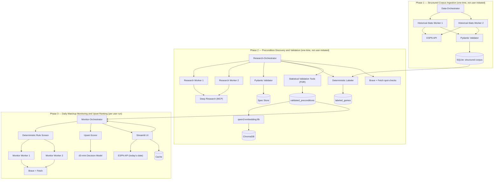
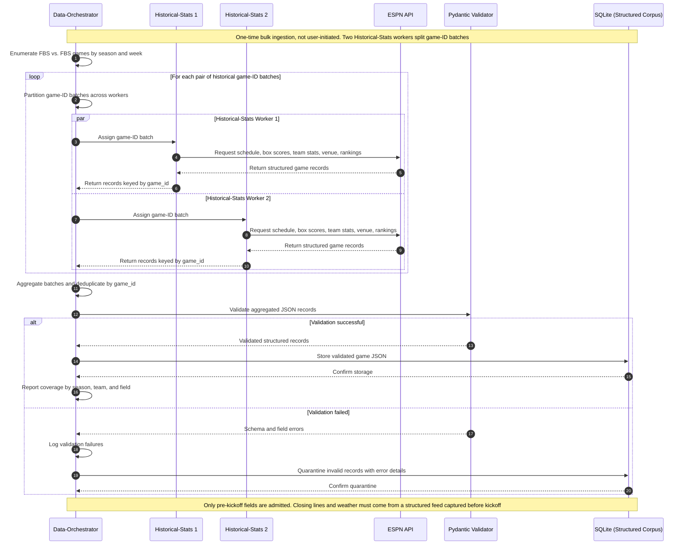
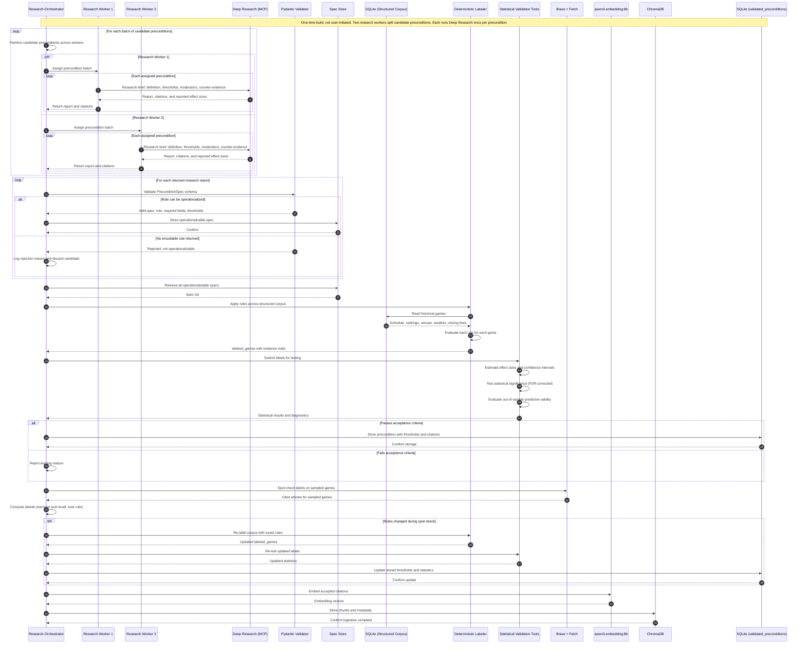
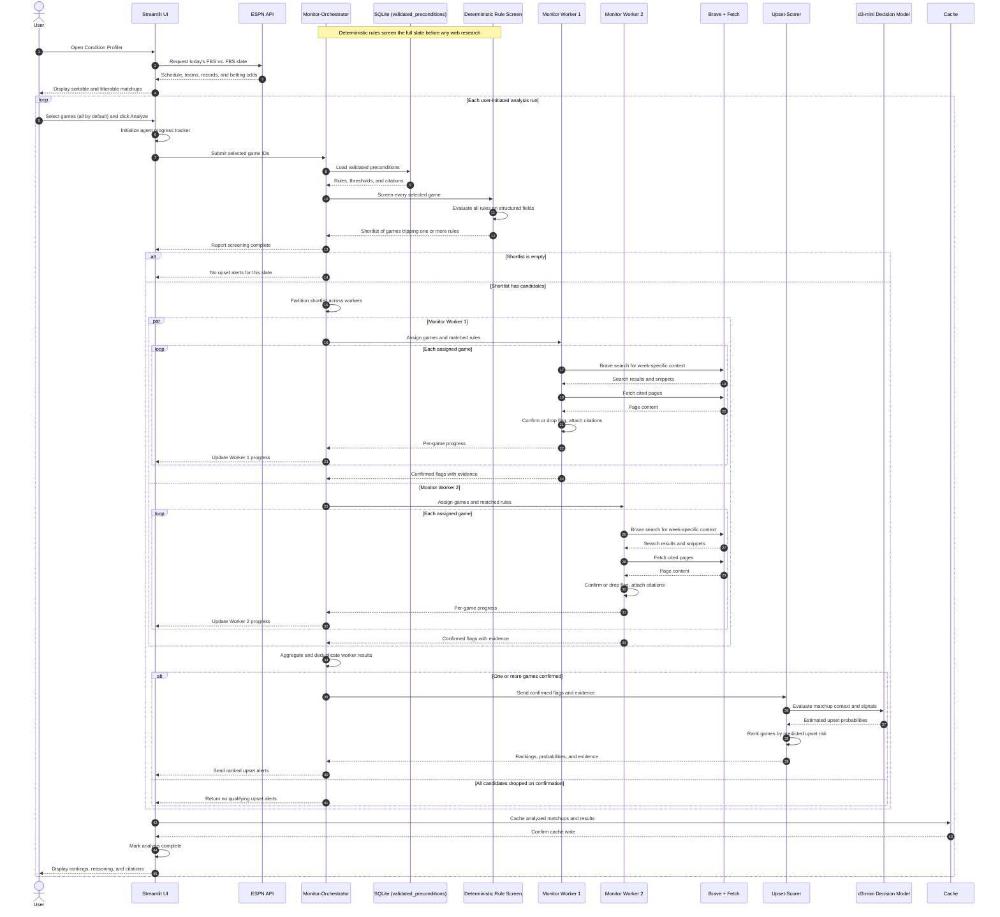

# CFB Upset Precondition Profiler

A multi-agent system that profiles the common preconditions of college football upsets and uses them to flag, explain, and rank upset risk on a live slate of NCAA Division I FBS games.

**Course:** ADS 5984 — Agentic AI in Practice
**Project:** 34.4.13 Sports: Upset Condition Profiler
**Design document:** [`reference_documents/final_project_reqs_and_arch.qmd`](reference_documents/final_project_reqs_and_arch.qmd)

---

## Overview

Anyone can forecast a football game. The hard part is knowing *which* games are the actual upsets.

Football is a high-variance sport. A substantial share of results is noise and luck, so the empirically better team can lose a single game even if it would win more than 50% of a thousand simulated meetings. A 13–14 point standard deviation of scoring-margin error relative to the expected margin is a well-supported estimate — the best team does not always win. At the same time, betting markets are accurate (mainstream sources sit around a **~10 point MAE** on final scoring margin), so simply disagreeing with the market is not a strategy.

The user of this project is an **analyst or reporter covering the sport** whose job is to research, break down, and highlight upcoming matchups. Today, surfacing upset risk means manually working through advanced metrics and model inputs while also accounting for factors that people and models routinely overlook:

- travel fatigue
- revenge games
- rest days between games
- overlooking an opponent ahead of a marquee matchup

None of that research is impossible — but with dozens of games on a given day, plus every other responsibility an analyst carries, it does not get done. This project streamlines that research and returns **upset predictions with justifications grounded in the common factors behind past upsets**.

### What this system does

Historical upset research → precondition discovery and statistical validation → daily matchup monitoring → explainable, ranked upset alerts, all exposed through a Streamlit UI that shows agent activity.

### Scope

| In scope | Out of scope |
| --- | --- |
| Historical upset research | Guaranteed score or scoring-margin predictions |
| Upcoming matchup monitoring | Real-time in-game analysis |
| Upset risk scoring | Automated sports betting |
| Multi-agent orchestration | Any sport outside NCAA Division I FBS |
| Explainable recommendations | Player-level forecasting |

### What a successful run looks like

An autonomous run in which the `Monitor-Orchestrator` produces confirmed flags and compiled research, the `Upset-Scorer` turns them into an upset score, and the day's games come back ranked **1 to n** with explanations and citations — all rendered in the final Streamlit deliverable.

### Why this needs multiple agents

A single agent or a plain script could technically be attempted, but would produce an unsatisfactory product:

- **Context overflow.** One context window would hold mostly irrelevant material from every task (ingestion, research, monitoring, scoring), degrading output quality.
- **Lost parallelism.** The precondition research splits across workers, and the daily slate splits across monitor workers. Those steps are independent and parallelizable; a single agent serializes them.
- **Hard to debug and audit.** Validation, rejection reasons, and evidence trails disappear into one undifferentiated transcript.

The design therefore leans on specialized agents with short, focused contexts, explicit validation handoffs, and parallel phases.

---

## Architecture

The solution combines an **orchestrator–worker** pattern with **sequential pipeline stages**.

> **Level of agency earned:** a multi-agent orchestrator–worker design with sequential pipeline stages. It is earned by the need for parallelism (research workers splitting independent preconditions, monitor workers splitting games) and because the plan is fixed upfront. Unlike a Supervisor-Router design that works fully sequentially in an effectively ReAct loop, workers here never need to talk to each other — only to their orchestrator.

### Phase map



Full UML sequence diagrams — including `loop`, `par`, `alt`, and `opt` blocks — follow each phase description below, and also appear in the design document.

### Phase 1 — Structured corpus ingestion

A one-off bulk ingestion, not user-initiated.

1. The `Data-Orchestrator` enumerates FBS vs. FBS games by season and week and partitions game-ID batches across two `Historical-Stats` workers.
2. Each worker pulls schedule, box scores, team statistics, venue, and rankings from the **ESPN API**, returning records keyed by `game_id`. There is no per-game web research in this phase.
3. The orchestrator aggregates, deduplicates by `game_id`, and hands the JSON to the **Pydantic validator**.
4. On success, validated records go to the **SQLite structured corpus** and coverage is reported by season, team, and field. On failure, schema/field errors are returned, logged, and the invalid records are quarantined with error details.

> **Leakage guard:** only pre-kickoff fields are admitted. Closing lines and weather must come from a structured feed captured before kickoff.

#### Phase 1 sequence diagram



### Phase 2 — Precondition discovery and validation

A one-time build, not user-initiated. This phase researches **preconditions, not games** — `Deep Research` runs once per precondition candidate, and the resulting rules are applied deterministically across the whole corpus.

1. The `Research-Orchestrator` partitions ~20 candidate preconditions across two `Research Workers`.
2. Each worker sends a research brief to **Deep Research** (definition, operational thresholds, plausible moderators, counter-evidence) and receives a report, citations, and reported effect sizes.
3. Each report passes a Pydantic schema gate. If it can be encoded as a rule (field, operator, threshold, units), it lands in the **Spec Store**; if not, it is rejected as not operationalizable and the reason is logged.
4. The **Deterministic Labeler** evaluates every spec against every historical game and writes `labeled_games` with evidence trails.
5. **Statistical Validation Tools** estimate effect sizes and confidence intervals, test significance with **FDR correction**, and check out-of-sample predictive validity. Passing preconditions are promoted to `validated_preconditions`; failures are rejected with a logged reason.
6. A **Brave + Fetch** spot-check on sampled labels computes labeler precision/recall, and rules are tuned where disagreements appear. If rules changed, the corpus is re-labeled and re-tested (an `opt` step).
7. Accepted citations are embedded with `qwen3-embedding:8b` and stored as chunks + metadata in **ChromaDB**.

#### Phase 2 sequence diagram



### Phase 3 — Daily matchup monitoring and upset ranking

Per user run, from the Streamlit UI.

1. The UI requests **today's FBS vs. FBS slate** from the ESPN API and displays it as a sortable, filterable list with team colors and minimalistic helmet logos.
2. Games default to **all selected**; the user may narrow the set, then click **Analyze**. The UI initializes an agent progress tracker and submits the selected game IDs.
3. The `Monitor-Orchestrator` loads validated preconditions and runs the **Deterministic Rule Screen** over the full slate *before any web research*, producing a shortlist of games tripping one or more rules.
4. The shortlist is partitioned across two `Monitor Workers`. Each uses **Brave** search and **Fetch** for week-specific context, confirms or drops the flag, attaches citations, and streams per-game progress back to the UI.
5. Confirmed flags and evidence go to the `Upset-Scorer`, which uses the **VT ARC d3-mini decision model** to estimate upset probabilities and rank games by risk, returning rankings, probabilities, and evidence.
6. The UI caches analyzed matchups and results, then displays rankings, reasoning, and citations.

Empty cases are handled explicitly: an empty shortlist returns "no upset alerts for this slate," and an all-dropped confirmation stage returns "no qualifying upset alerts."

#### Phase 3 sequence diagram



---

## Components

| Component | Role |
| --- | --- |
| **Streamlit UI** | Sortable/filterable slate, game selection, agent progress, ranked results |
| **Data-Orchestrator** | Partitions historical game-ID batches, aggregates, validates, stores |
| **Historical-Stats Workers (×2)** | Parallel ESPN API retrieval of structured historical game records |
| **Research-Orchestrator** | Partitions preconditions, validates specs, drives labeling and testing |
| **Research Workers (×2)** | One `Deep Research` brief per precondition candidate |
| **Deep Research (MCP)** | Definitions, thresholds, moderators, counter-evidence, citations |
| **Pydantic Validator** | Schema enforcement at every handoff; rejects non-operationalizable specs |
| **Spec Store** | Versioned `PreconditionSpec` records: rule, required fields, thresholds |
| **Deterministic Labeler** | Applies every spec to every game; emits evidence trails |
| **Statistical Validation Tools** | Effect sizes, CIs, FDR-corrected significance, out-of-sample validity |
| **Brave + Fetch** | Web search and page fetch for spot-checks and per-game confirmation |
| **qwen3-embedding:8b** | Embeds accepted citations |
| **Monitor-Orchestrator** | Loads validated preconditions, screens the slate, fans out workers, aggregates |
| **Deterministic Rule Screen** | Structured-field screening before any web research |
| **Monitor Workers (×2)** | Confirm/drop flags with citations for assigned games |
| **Upset-Scorer** | Ranks confirmed upsets using the d3-mini decision model |
| **ESPN API** | Historical structured data and the daily FBS vs. FBS slate |
| **ChromaDB** | Accepted citations as embedded chunks + metadata |
| **Cache** | Analyzed matchups and results, to cut latency on repeat runs |

### Data stores

SQLite holds the corpus, specs, `labeled_games`, and `validated_preconditions`:

- `precondition_spec`
- `spec_store`
- `labeled_games`
- `validated_preconditions`

ChromaDB holds the accepted citations.

---

## Requirements

Numbered as in the design document; later sections and mitigations refer back to these numbers.

1. Provide a usable, responsive **Streamlit** UI that exposes the solution and shows agent activity.
2. Let the user sort/filter today's games by fields, or select specific games for `Monitor-Orchestrator` / `Upset-Scorer` analysis.
3. Let the user rerun the process as many times as they wish with any combination of games.
4. Use an orchestrator–worker architecture for historical structured ingestion, with a `Data-Orchestrator` driving two workers that batch-retrieve past games from ESPN's API.
5. Let `Research-Orchestrator` workers use **Deep Research**, and `Monitor-Orchestrator` workers use **Brave** and **Fetch**.
6. Parallelize the work of all orchestrator agents to cut latency on long, expensive tasks.
7. Let `Research-Orchestrator` aggregate worker findings, enforcing Pydantic's JSON schema and validating results.
8. Store the corpus, specs, `labeled_games`, and `validated_preconditions` in **SQLite**; hold accepted citations in **ChromaDB**.
9. Use a deterministic labeler and statistical validation tools to decide which researched preconditions are real signal, combining `Research Worker` output with `Data-Orchestrator` data.
10. Use a batch pipeline that extracts the day's scheduled games from the ESPN API for the user's chosen games — FBS vs. FBS only — with team, location, team statistics, weather, and betting odds to establish the favorite.
11. Retrieve daily matchups for `Monitor-Orchestrator` and the Streamlit slate display from the ESPN API.
12. Assign only the selected games to parallel `Monitor Worker` agents that use each game's structured data plus `Brave Search` and `Fetch` to confirm or drop the flag and attach citations, returning confirmed flags with evidence.
13. Have `Monitor-Orchestrator` provide a rationale for every confirmed flag explaining why the game is a potential upset.
14. Have `Upset-Scorer` consume `Monitor-Orchestrator` output (rationale + confirmed flags) and use VT ARC's **d3-mini** decision model to score and rank the most likely upsets.
15. Have the research pipeline write its output to SQLite tables `precondition_spec`, `spec_store`, `labeled_games`, and `validated_preconditions`.
16. Provide well-structured code with descriptive comments and run instructions.
17. Run the two `Monitor Workers` in parallel under `Monitor-Orchestrator`.
18. Provide cited rationale and confirmed evidence from `Monitor-Orchestrator` alongside the `Upset-Scorer` decision-model score.
19. Be highly reliable: rerunning the ranker on the same matchups must produce relatively consistent results. Wildly different results are a complete failure.
20. Use a `.env` kept out of Git, with `.env.example` as boilerplate for the user.
21. Conform to standardized JSON output using Pydantic to prevent broken handoffs.
22. Handle API failures, LLM timeouts, and MCP failures without crashing the application.
23. Cache matchups that have already been analyzed.
24. Guarantee no post-kickoff data influences a label, precondition spec, or upset score, via the deterministic filter `known_at < kickoff_time`.
25. Validate `Upset-Scorer` probabilities: **2021–2023** train, **2024** validation, **2025** test — so the outputs are known to be meaningful.
26. Run `Deep Research` once per precondition candidate (not once per game), then apply rules deterministically across the corpus.
27. Store `PreconditionSpec`s with a rule, required fields, and thresholds, with versioning, in a SQLite table.
28. Provide a deterministic labeler applied to every spec/game pair, emitting `labeled_games` with evidence trails.
29. Screen the slate deterministically first; only games matching at least one precondition get further web research.
30. Sample a fixed number of labeled games, using `Brave` and `Fetch`, to compute precision/recall for testing.
31. Use a False Discovery Rate–corrected approach in statistical testing on out-of-sample observations.
32. Report non-null percentages for every field, team, and attribute to surface missing data.

---

## Risks and Mitigations

For each identified LLM/RAG failure mode: the design pattern that addresses it, and why that pattern is the right choice.

### 1. Hallucination (Requirement 5)

Confident but inaccurate output driven by lost-in-the-middle context, context overflow, or unclear instructions. In this system it would poison `Research-Orchestrator` output and let `Monitor-Orchestrator` confidently flag games using false assumptions about upset preconditions.

**Mitigation:** cap the information each worker sees by sending **batches of preconditions** rather than the whole candidate set, and position the most relevant content at the front or back of the context. Narrow, focused contexts are the point — letting workers accumulate documents across many preconditions is exactly what produces pollution and hallucination.

### 2. Prompt injection (Requirement 5)

Workers read large volumes of open-web research material, so malicious or faulty content can steer them toward incorrect conclusions.

**Mitigation:** a **manually whitelisted set of sources** — ESPN.com, Sports-Reference.com, and credible local media — for all extraction. This is the simplest and most effective control, because "make sure the website is legitimate" is an instruction, not a guarantee.

### 3. Label noise from vague research (Requirement 9)

`Deep Research` returns prose. An underspecified phrase like "short rest" becomes an arbitrary threshold that the deterministic labeler applies to every game, filling `validated_preconditions` with noise instead of signal.

**Mitigation:** a **schema gate** that accepts only an operational rule — field, operator, threshold, units — before anything reaches the Spec Store. Prose that cannot be encoded that way is rejected with a logged reason, which is what makes the labeler apply the same rule the same way every time.

### 4. Inconsistency and nondeterminism (Requirement 19)

LLMs sample tokens, so the same slate can produce very different rankings — which would make the product useless.

**Mitigation:** use the **d3-mini decision model** for scoring inside `Upset-Scorer`. Decision models score candidates against a probability distribution instead of sampling output tokens, giving more consistent answers than a conventional LLM while also avoiding added latency.

### 5. Invalid structured output (Requirement 21)

Any tool call or database write can break if the model's JSON does not match the expected schema — invalid syntax, wrong types, bad values.

**Mitigation:** **Pydantic validation as a required hop**, with the orchestrator validating its workers' responses. The orchestrator is already the central coordinator of its workers, so making it the validation checkpoint adds no new topology and catches the cases Pydantic alone does not (malformed syntax, out-of-range values).

### 6. Data leakage (Requirement 24)

Weather, closing lines, and other fields may be updated after the game ends, and a fetched page published before kickoff can be edited afterward. Leakage would inflate apparent accuracy and corrupt every downstream artifact.

**Mitigation:** a **deterministic timestamp on every field** rather than agent judgment. Every structured column carries a `known_at` time, every fetch carries a `report_time`, and anything missing or dated after kickoff is discarded before `Upset-Scorer` ever sees it.

---

## Reliability and evaluation

- **Repeatability (Req. 19):** same matchups in, materially the same ranking out.
- **Probabilistic validation (Req. 25):** train on 2021–2023, validate on 2024, test on 2025. Report **log loss**, **Brier score**, and a **calibration plot**. Without this, first-ship `Upset-Scorer` probabilities would be effectively meaningless.
- **Rule quality (Reqs. 30–31):** precision/recall from Brave + Fetch spot-checks, plus effect sizes, confidence intervals, and FDR-corrected significance on out-of-sample observations.
- **Data quality (Req. 32):** non-null percentages per field, team, and attribute.
- **Fault tolerance (Req. 22):** every model call, tool call, MCP call, and API request is wrapped to handle timeouts and failures without crashing or silently degrading output.

---

## Getting started

> **Status:** this repository currently contains the design and requirements phase. The application code described below is the implementation target; this section documents how the system is intended to be run and will be finalized as modules land.

### Prerequisites

- Python 3.11+
- Access to the ESPN API (no key required for the public endpoints used)
- A VT ARC account with access to the **d3-mini** decision model
- MCP servers for **Deep Research**, **Brave Search**, and **Fetch**
- An embedding endpoint serving `qwen3-embedding:8b`

### Setup

```bash
git clone <repository-url>
cd cfb-upset-precondition

python -m venv .venv
source .venv/bin/activate
pip install -r requirements.txt

cp .env.example .env    # then fill in your credentials
```

### Environment variables

`.env` is git-ignored; `.env.example` is the committed boilerplate. Expected keys:

| Key | Purpose |
| --- | --- |
| `VT_ARC_API_KEY` | Authenticates VT ARC model calls, including `d3-mini` |
| `VT_ARC_BASE_URL` | VT ARC endpoint base URL |
| `VT_ARC_MODEL` | Model identifier used by agent nodes |
| `VT_ARC_DECISION_MODEL` | `d3-mini` decision-model identifier used by `Upset-Scorer` |
| `BRAVE_API_KEY` | Brave Search MCP credentials |
| `FETCH_BASE_URL` | Fetch MCP endpoint |
| `DEEP_RESEARCH_BASE_URL` | Deep Research MCP endpoint |
| `EMBEDDING_BASE_URL` | `qwen3-embedding:8b` endpoint |
| `SQLITE_PATH` | Path to the SQLite database |
| `CHROMA_PATH` | Path to the ChromaDB persistence directory |
| `CACHE_PATH` | Path to the analyzed-matchup cache |
| `ESPN_API_BASE_URL` | ESPN API base URL |
| `LOG_LEVEL` | Application log verbosity |

### Run order

```bash
# Phase 1 — one-time structured corpus ingestion (not user-initiated)
python -m cfb_upset.pipelines.ingest_corpus --seasons 2021 2022 2023 2024 2025

# Gate check: dedupe, zero leaked fields, and an independent +/-5% count per season
python scripts/verify_corpus.py --db data/cfb.db --seasons 2021 2022 2023 2024 2025

# Phase 3 — leakage-safe features, favourite policy, splits, and labels
python -m cfb_upset.pipelines.build_features --db data/cfb.db
# optional one-time enrichment (already cached in data/cfb.db after the first run):
#   --live-venues  CFBD /venues for travel/altitude/timezone
#   --cfbd-lines   CFBD spreadOpen, the primary favourite source (D4)

# Phase 2 — one-time precondition discovery, labeling, and validation
python -m cfb_upset.research.build_preconditions

# Phase 3 — daily monitoring UI
streamlit run app.py
```

The ingest command writes `reports/coverage_<timestamp>.md`/`.json` and is idempotent;
add `--resume` to skip already-stored games without re-fetching their summaries.

Phases 1 and 2 build the corpus, the spec store, `labeled_games`, `validated_preconditions`, and the ChromaDB citation index. Phase 3 is the analyst-facing app: pick a slate, click **Analyze**, and watch the agents work.

### Proposed layout

```
cfb-upset-precondition/
├── app.py                        # Streamlit entry point
├── cfb_upset/
│   ├── agents/                   # orchestrators, workers, scorer
│   ├── schemas/                  # Pydantic models (PreconditionSpec, flags, results)
│   ├── ingest/                   # ESPN historical + daily slate pipelines
│   ├── labeling/                 # deterministic labeler and rule screen
│   ├── stats/                    # effect sizes, FDR correction, calibration
│   ├── store/                    # SQLite, ChromaDB, cache adapters
│   └── mcp/                      # Deep Research, Brave, Fetch clients
├── data/                         # SQLite DB, Chroma persistence, cache
├── reference_documents/          # requirements, architecture, specs
└── .env.example
```

---

## Reference documents

- [`reference_documents/final_project_reqs_and_arch.qmd`](reference_documents/final_project_reqs_and_arch.qmd) — full requirements, architecture, actor lists, phase sequence diagrams, and mitigations
- [`reference_documents/final_project_specifications.md`](reference_documents/final_project_specifications.md) — course project specifications and rubric
- [`reference_documents/ten_principles_for_reliable_multi_agent_systems.md`](reference_documents/ten_principles_for_reliable_multi_agent_systems.md) — reliability principles applied to the agent design
