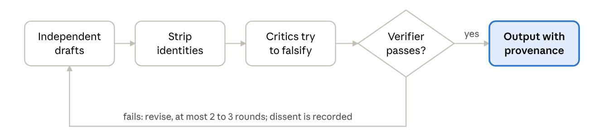

# 10 Principles for Reliable Multi-Agent Systems

Oct 2, 2026 · @Scott Mutchler

A multi-agent system is only as reliable as the process wrapped around its models. Individual LLMs have well-documented weaknesses: they defer to whoever sounds confident, they lose track of information in long contexts, they state falsehoods fluently, and they grade their own work generously. Good design patterns don't wish these weaknesses away. They build a process in which each one gets caught.

This matters more every month. Agents now run long, mostly unsupervised tasks: multistep research, code changes across a repository, analyses that feed real decisions. In that setting an early mistake compounds through every later step, and no one reads every intermediate output. Adding more agents does not automatically help. Several studies find multi-agent systems often barely beat a single agent ([Cemri](https://arxiv.org/abs/2503.13657) et al., 2025), and some setups do worse (Yao et al., [2025\)](https://arxiv.org/abs/2509.23055).

The popular recipe is to give agents personas (skeptic, domain expert, devil's advocate), let them debate, and take the consensus. It sometimes works: debate improved math and factual accuracy in Du et al. [\(ICML](https://proceedings.mlr.press/v235/du24e.html) 2024), and varied roles beat identical ones in [Chan](https://proceedings.iclr.cc/paper_files/paper/2024/hash/25cc3adf8c85f7c70989cb8a97a691a7-Abstract-Conference.html) et al. (ICLR [2024\).](https://proceedings.iclr.cc/paper_files/paper/2024/hash/25cc3adf8c85f7c70989cb8a97a691a7-Abstract-Conference.html) But debate didn't reliably beat simple majority voting in Smit et al. [\(ICML](https://proceedings.mlr.press/v235/smit24a.html) [2024\)](https://proceedings.mlr.press/v235/smit24a.html), and agents' sycophancy toward each other can collapse a debate into premature agreement (Pitre et al., [2025](https://aclanthology.org/2025.findings-acl.1141); Yao et al., [2025\)](https://arxiv.org/abs/2509.23055). Personas help agents focus, but they drift under peer pressure [\(Baltaji](https://aclanthology.org/2024.c3nlp-1.2) et al., 2024), so they can't carry reliability alone.

People faced the same problem long before LLMs: smart individuals who conform, anchor, overclaim, and favor their own work. The fixes became institutions. The scientific method makes claims face tests that can fail. The Delphi method and blind peer review gather judgments independently and strip identities. Audits separate the person who does the work from the person who checks it. The ten principles below translate those institutions into agent design, and each one targets specific LLM weaknesses.

| LLM weakness | How it shows up in agent systems | Principles that counter it |
| --- | --- | --- |
| Sycophancy and conformity (Sharma et al., 2024) | Agents abandon correct answers to agree with peers; debates collapse early | 2 Independence, 3 Anonymity, 5 Falsification, 9 Preserve dissent |
| Context fragility (Liu et al., 2024) | Details lost in long transcripts or handoffs; early framings anchor later reasoning | 2 Independence, 8 Provenance, 9 Fresh contexts |
| Fluent falsehoods | Plausible but unsupported claims pass between agents unchallenged | 1 Deterministic validation, 8 Provenance |
| Weak self-correction (Huang et al., 2024) | Agents "fix" correct answers or miss their own errors without outside feedback | 1 Deterministic validation, 6 Separate judge |
| Self-preference (Panickssery et al., 2024) | Judges favor their own outputs or their own model's style | 3 Anonymity, 6 Separate judge |
| Correlated errors | Copies of one model share blind spots, so agreement adds little | 4 Real diversity |
| Specification gaming | Agents satisfy the check rather than the goal, such as editing tests | 7 Hard-to-game verifiers |
| Unmeasured gains | Extra agents and compute look like progress without beating a simple baseline | 10 Measure honestly |

The thread running through all ten: treat agreement between agents as weak evidence and external checks as strong evidence. The principles come first, then a reference pipeline that combines them, then notes on building it in Claude Code and OpenCode.

## 1. Let deterministic validation decide

Wherever a check exists that doesn't depend on a model's opinion, it should be the arbiter: tests that run, a proof checker, a recomputed number, a retrieved source. [Huang](https://arxiv.org/abs/2310.01798) et al. (ICLR [2024\)](https://arxiv.org/abs/2310.01798) found that models struggle to correct their own reasoning without external feedback, sometimes getting worse when they try, and that earlier reports of self-correction gains relied on oracle labels. Debate is useful for generating candidates and critiques. The verifier, not the vote, picks the winner.

## 2. Draft independently before anyone sees anyone else

Every agent should commit to its own answer before reading the others. Once agents see each other's work, their answers converge whether or not they get more accurate. [Lorenz](https://doi.org/10.1073/pnas.1008636108) et al. [\(PNAS](https://doi.org/10.1073/pnas.1008636108) 2011) showed the same effect in human crowds: seeing others' estimates narrowed the spread of answers without reducing the group's error, while raising confidence. Independence is what makes multiple agents worth more than one agent sampled several times.

## 3. Strip identities from what agents review

When an agent knows which answer is its own and which is a peer's, it weights them by identity, not content. Choi, Zhu and Li (ACL [2026\)](https://arxiv.org/abs/2510.07517) found this identity bias is widespread and runs far more often toward sycophancy (adopting a peer's view uncritically) than toward stubbornness. Their fix was anonymizing responses so agents can't tell self from peer, which reduced the bias. The Delphi method and blind peer review use the same trick for people.

## 4. Use personas, then add real diversity

Personas are useful. Giving agents distinct roles (skeptic, security reviewer, domain expert) focuses their attention, and in Chan et al. (ICLR [2024\)](https://proceedings.iclr.cc/paper_files/paper/2024/hash/25cc3adf8c85f7c70989cb8a97a691a7-Abstract-Conference.html) varied roles beat identical ones. They just aren't the strongest lever on their own, since agents drift out of assigned personas under peer pressure [\(Baltaji](https://aclanthology.org/2024.c3nlp-1.2) et al., 2024). Treat personas as a cheap first layer, then add diversity that changes what an agent can know or how it errs: different model families, retrieved evidence, tools, or decompositions of the problem. In Yao et al. [\(2025\)](https://arxiv.org/abs/2509.23055), a debate among copies of one model collapsed into agreement most often and gained nothing over a single agent, and *If [Multi-Agent](https://arxiv.org/abs/2502.08788) Debate is the Answer, What is the [Question?](https://arxiv.org/abs/2502.08788)* [\(2025\)](https://arxiv.org/abs/2502.08788) found mixing different models improved debate. A useful test: could two agents fail in different ways? If only their prompts differ, they likely share blind spots.

## 5. Ask critics to falsify, not to review

"Review this answer" invites polite agreement, especially from models trained to be helpful. Give the critic a concrete target instead: find the strongest evidence this is wrong, name the assumption most likely to fail, write a test this code should fail. Popper's point applies directly. A claim earns confidence by surviving serious attempts to break it, not by collecting approval.

## 6. Keep the judge separate from the author

LLM evaluators tend to rate their own outputs higher than equally good outputs from others, and this self-preference tracks how well they recognize their own text [\(Panickssery,](https://papers.nips.cc/paper_files/paper/2024/hash/7f1f0218e45f5414c79c0679633e47bc-Abstract-Conference.html) Bowman and Feng, NeurIPS 2024). When a judgment can't be made deterministic, make it at arm's length: a different model, a fresh context with no access to the debate, or a rubric scored item by item. A judge that watched the whole debate has been persuaded by it.

## 7. Make the verifier hard to game

Agents optimizing against a check will find its gaps, for example by editing a test instead of fixing the code, or citing a source that doesn't say what's claimed. Keep some checks held out, so the producing agents never see them. Validate the validators: occasionally plant known errors and confirm the pipeline catches them.

## 8. Trace every claim to its evidence

Each claim in the output should point to a source, a run, or a computation. Unsourced assertions are where hallucinations hide, and provenance turns auditing from rereading everything into spot-checking links. Cemri et al. [\(NeurIPS](https://arxiv.org/abs/2503.13657) 2025) analyzed 1,600+ multiagent traces and found inter-agent misalignment and weak task verification among the main failure categories; provenance targets both.

## 9. Preserve dissent and limit interaction

Record minority positions with their reasons and confidence, and let agents abstain. An unresolved disagreement is often the most useful output: it marks exactly where a human or a verifier should look. Keep debates short, such as two or three rounds: [Wynn,](https://arxiv.org/abs/2509.05396) Satija

and [Hadfield](https://arxiv.org/abs/2509.05396) (2025) found accuracy can fall as debate goes on, with agents abandoning correct answers under peer influence. When a fresh judgment is needed, restart the agent with only the artifact, not the transcript, so early framings don't anchor it.

## 10. Measure honestly and keep humans at the hinges

Compare any multi-agent setup against one agent given the same compute, such as majority voting over several samples. Under that test, Smit et al. [\(2024\)](https://proceedings.mlr.press/v235/smit24a.html) and [Huang](https://arxiv.org/abs/2310.01798) et al. [\(2024\)](https://arxiv.org/abs/2310.01798) found debate's advantage over self-consistency unreliable. Track how often agents flip from right to wrong versus wrong to right, as Yao et al. [\(2025\)](https://arxiv.org/abs/2509.23055) do with their rate of abandoned correct answers; it's the most direct measure of whether interaction is helping. Then automate the cheap, checkable loops and put a person at the decisions that are costly or irreversible, or where ground truth is ambiguous.

## Putting it together



reliable multi-agent pipeline · 4 steps, 1 check

Agents draft alone, review each other blind, and attack the answers; only a passing check releases an output, and a failure loops back with the dissent attached.

None of this requires exotic tooling. It requires deciding, before you build, what counts as evidence. If the only evidence your system produces is agents agreeing with each other, more agents and better personas will mostly buy you more confident mistakes. If it produces checks that can fail, every principle above makes those checks sharper.

## Implementing it in Claude Code and OpenCode

Both tools already have the parts you need: isolated subagents, per-agent models and permissions, lifecycle hooks, MCP servers, and skills. Claude Code configures hooks in .claude/settings.json and agents in .claude/agents/\*.md ; OpenCode uses opencode.json , agents in .opencode/agents/\*.md , and JavaScript/TypeScript plugins in .opencode/plugins/ .

| Principle | Claude Code | OpenCode |
| --- | --- | --- |
| 1, 7. Verifier decides, and can't be gamed | A `Stop` or `SubagentStop` hook runs the test suite and exits with code 2 on failure, which keeps the agent working. A `PostToolUse` hook on `Edit\|Write` runs linters. Add a `permissions.deny` rule such as `Edit(tests/**)` so agents can't edit the checks. | A plugin runs checks in `tool.execute.after` or on the `session.idle` event; throwing in `tool.execute.before` blocks a tool call. Per-agent `permission.edit` accepts glob patterns, so `tests/**` can be set to `deny`. |
| 2, 9. Independent drafts, fresh contexts | Each subagent runs in its own context window; launch drafters in parallel. `isolation: worktree` gives each one its own checkout. | Subagents run as child sessions; the built-in `general` subagent is meant for parallel units of work. |
| 3. Anonymity | No built-in feature. Have the orchestrator save drafts as neutral files (`draft-a.md`, `draft-b.md`) and pass reviewers only the files, never agent names. | Same approach. |
| 4. Personas plus real diversity | Agent files set a role prompt and model (`opus`, `sonnet`, `haiku`). For other model families, expose them through an MCP server. | Agents set model as `provider/model-id`, so one pipeline can mix providers directly. |
| 5, 6. Falsifying critic, separate judge | A read-only critic agent with `disallowedTools: Write, Edit`, a different model, and a prompt that asks it to break the answer. `type: "agent"` hooks (experimental) can run a verifier subagent at a lifecycle point. | A critic agent with `mode: subagent`, `permission: { edit: deny }`, a different model, and low temperature. |
| 8. Provenance | Retrieval and search MCP servers (`claude mcp add`) so evidence arrives with its source; a skill that defines the citation format. | MCP servers under `mcp` in `opencode.json`; the same skill. |
| 9, 10. Cap rounds, measure, humans at hinges | `maxTurns` per subagent. Hooks receive `agent_type` in their JSON input, so a `SubagentStop` hook can log each agent's answer to measure flips. A `PreToolUse` hook returning `permissionDecision: "ask"` forces human review. | `steps` caps iterations per agent. Plugin events such as `message.updated` feed logging via `client.app.log()`. Set risky permissions to `"ask"`. |

Package the protocol itself as a skill: one SKILL.md describing the steps (independent drafts, anonymized critique, verifier, dissent log). OpenCode also reads skills from .claude/skills/<name>/SKILL.md , so a single skill can serve both tools.

A minimal critic agent in Claude Code ( .claude/agents/critic.md ):

```yaml
---
name: critic
description: Tries to falsify a proposed answer. Use after drafts are written.
disallowedTools: Write, Edit
model: opus
maxTurns: 10
---
You review anonymized drafts. For each, find the strongest evidence it is wrong,
name the assumption most likely to fail, and propose a check that would expose it.
Do not soften findings to be agreeable.
```

The OpenCode equivalent ( .opencode/agents/critic.md ):

```yaml
---
description: Tries to falsify a proposed answer. Use after drafts are written.
mode: subagent
model: openai/gpt-5
temperature: 0.1
steps: 10
permission:
  edit: deny
---
You review anonymized drafts. For each, find the strongest evidence it is wrong,
name the assumption most likely to fail, and propose a check that would expose it.
```

Docs: Claude Code [hooks,](https://code.claude.com/docs/en/hooks) [subagents](https://code.claude.com/docs/en/sub-agents), [MCP](https://code.claude.com/docs/en/mcp), [skills](https://code.claude.com/docs/en/skills); OpenCode [agents](https://opencode.ai/docs/agents/), [plugins,](https://opencode.ai/docs/plugins/) [MCP](https://opencode.ai/docs/mcp-servers/) [servers](https://opencode.ai/docs/mcp-servers/), [skills.](https://opencode.ai/docs/skills/) Both tools change quickly; check field names against the current docs.

## References

Baltaji, R., Hemmatian, B., and Varshney, L. R. (2024). Conformity, [Confabulation,](https://aclanthology.org/2024.c3nlp-1.2) and [Impersonation:](https://aclanthology.org/2024.c3nlp-1.2) Persona Inconstancy in Multi-Agent LLM Collaboration. C3NLP Workshop, ACL 2024. Cemri, M., Pan, M. Z., et al. (2025). Why Do [Multi-Agent](https://arxiv.org/abs/2503.13657) LLM Systems Fail? NeurIPS 2025.

Chan, C.-M., Chen, W., Su, Y., et al. (2024). ChatEval: Towards Better [LLM-based](https://proceedings.iclr.cc/paper_files/paper/2024/hash/25cc3adf8c85f7c70989cb8a97a691a7-Abstract-Conference.html) Evaluators through [Multi-Agent](https://proceedings.iclr.cc/paper_files/paper/2024/hash/25cc3adf8c85f7c70989cb8a97a691a7-Abstract-Conference.html) Debate. ICLR 2024. Choi, H. K., Zhu, X., and Li, S. (2026). When Identity Skews Debate: [Anonymization](https://arxiv.org/abs/2510.07517) for [Bias-Reduced](https://arxiv.org/abs/2510.07517) Multi-Agent Reasoning. ACL 2026. Du, Y., Li, S., Torralba, A., Tenenbaum, J. B., and Mordatch, I. (2024). [Improving](https://proceedings.mlr.press/v235/du24e.html) Factuality and Reasoning in Language Models through [Multiagent](https://proceedings.mlr.press/v235/du24e.html) Debate. ICML 2024, PMLR 235:11733–11763. Huang, J., Chen, X., Mishra, S., Zheng, H. S., Yu, A. W., Song, X., and Zhou, D. (2024). Large Language Models Cannot [Self-Correct](https://arxiv.org/abs/2310.01798) Reasoning Yet. ICLR 2024. If [Multi-Agent](https://arxiv.org/abs/2502.08788) Debate is the Answer, What is the Question? (2025). arXiv preprint 2502.08788. Liu, N. F., Lin, K., Hewitt, J., Paranjape, A., Bevilacqua, M., Petroni, F., and Liang, P. (2024). Lost in the Middle: How [Language](https://arxiv.org/abs/2307.03172) Models Use Long Contexts. TACL 12. Lorenz, J., Rauhut, H., Schweitzer, F., and Helbing, D. (2011). How Social [Influence](https://doi.org/10.1073/pnas.1008636108) Can [Undermine](https://doi.org/10.1073/pnas.1008636108) the Wisdom of Crowd Effect. PNAS 108(22): 9020–9025. Panickssery, A., Bowman, S. R., and Feng, S. (2024). LLM [Evaluators](https://papers.nips.cc/paper_files/paper/2024/hash/7f1f0218e45f5414c79c0679633e47bc-Abstract-Conference.html) Recognize and Favor Their Own [Generations.](https://papers.nips.cc/paper_files/paper/2024/hash/7f1f0218e45f5414c79c0679633e47bc-Abstract-Conference.html) NeurIPS 2024. Pitre, P., Ramakrishnan, N., and Wang, X. (2025). [CONSENSAGENT:](https://aclanthology.org/2025.findings-acl.1141) Towards Efficient and Effective Consensus in Multi-Agent LLM Interactions Through [Sycophancy](https://aclanthology.org/2025.findings-acl.1141) [Mitigation](https://aclanthology.org/2025.findings-acl.1141). Findings ofACL 2025. Sharma, M., Tong, M., Korbak, T., et al. (2024). Towards [Understanding](https://arxiv.org/abs/2310.13548) Sycophancy in [Language](https://arxiv.org/abs/2310.13548) Models. ICLR 2024. Smit, A. P., Grinsztajn, N., Duckworth, P., Barrett, T. D., and Pretorius, A. (2024). [Should](https://proceedings.mlr.press/v235/smit24a.html) We Be Going MAD? A Look at [Multi-Agent](https://proceedings.mlr.press/v235/smit24a.html) Debate Strategies for LLMs. ICML 2024, PMLR 235. Wynn, A., Satija, H., and Hadfield, G. (2025). Talk Isn't Always Cheap: [Understanding](https://arxiv.org/abs/2509.05396) Failure Modes in [Multi-Agent](https://arxiv.org/abs/2509.05396) Debate. arXiv preprint 2509.05396. Yao, B., et al. (2025). Peacemaker or [Troublemaker:](https://arxiv.org/abs/2509.23055) How Sycophancy Shapes Multi-Agent [Debate.](https://arxiv.org/abs/2509.23055) arXiv preprint 2509.23055.